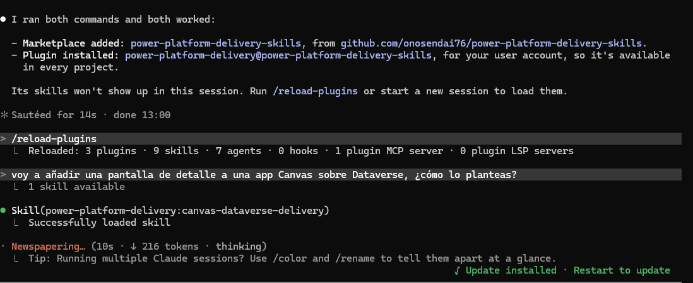
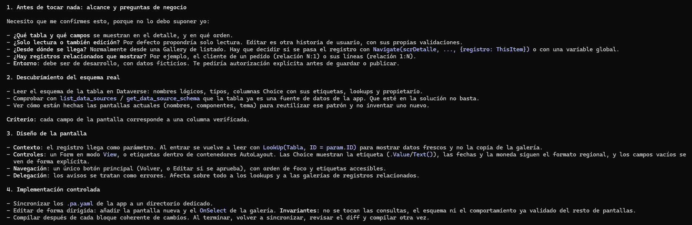
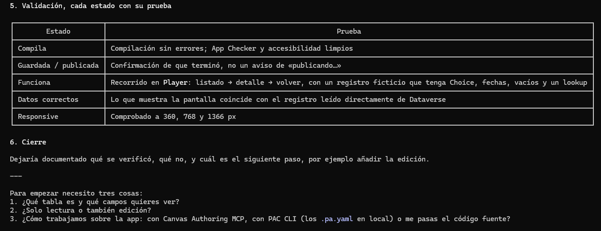

# Power Platform Delivery Skills

Skills abiertas para que los agentes de IA construyan y entreguen soluciones de Microsoft Power Platform **con oficio**: sin inventar el esquema, con alcance acotado y con una prueba para cada paso.

Una iniciativa de [Under the Platform](https://undertheplatform.com).

> **Estado: experimental (v0.x).** Las skills nacen de laboratorios reales, pero todavía se están contrastando en más proyectos. Úsalas, rómpelas y cuéntanos qué falla.

## Por qué existe

Microsoft publica skills oficiales ([power-platform-skills](https://github.com/microsoft/power-platform-skills)) que enseñan a los agentes cómo funciona la plataforma: cómo editar una Canvas por MCP, cómo crear un flujo, cómo generar una página. Son la base y conviene tenerlas instaladas.

Lo que esas skills no cubren es el **cómo se entrega bien**: comprobar el esquema antes de escribir, no adivinar etiquetas de una Choice, tratar los avisos de delegación como errores, distinguir compilar de publicar y de funcionar, documentar decisiones y evidencias. Ese oficio es lo que intenta empaquetar este repositorio.

## Skills

| Skill | Para qué | Estado |
|---|---|---|
| [`canvas-dataverse-delivery`](skills/canvas-dataverse-delivery/SKILL.md) | Construir o cambiar una app Canvas sobre Dataverse con gates y evidencia | v0.3 · experimental |

## Instalación

El formato `SKILL.md` lo entienden varios agentes. Elige el tuyo.

**Claude Code**

```sh
claude plugin marketplace add onosendai76/power-platform-delivery-skills
claude plugin install power-platform-delivery
```

**GitHub Copilot CLI**

```sh
copilot plugin marketplace add onosendai76/power-platform-delivery-skills
copilot plugin install power-platform-delivery@power-platform-delivery-skills
```

**Hermes Agent, Codex u otros agentes**

Copia la carpeta `skills/canvas-dataverse-delivery` en la carpeta de skills de tu agente o del perfil que la vaya a usar.

Recomendado: instala también las skills oficiales de Microsoft (`canvas-apps`) y el servidor Canvas Authoring MCP. Esta skill se apoya en ellas.

## Cómo se usa

Pídele al agente la app como una historia de usuario: quién, qué necesita, cuándo está terminado y qué no se puede tocar. La skill se encarga de que el agente:

1. lea el esquema real antes de diseñar,
2. construya primero un vertical slice mínimo con datos ficticios,
3. compile, publique y valide en Player como pasos separados,
4. te devuelva solo las decisiones de negocio y documente el resto.

## Así se ve en uso

Claude Code, recién instalado el plugin. Basta con preguntar por una tarea de Canvas sobre Dataverse: la skill se activa sola, sin nombrarla.



Antes de tocar nada, el agente separa lo que debe preguntar de lo que puede resolver, propone leer el esquema real y fija qué no se puede tocar.



Y cada estado tiene su propia prueba: compilar, publicar, funcionar en Player y leer de vuelta en Dataverse son pasos distintos.



## Principios

- El contrato vale más que el prompt.
- Preguntar antes de suponer.
- Cada estado tiene su prueba.
- El agente trabaja con tus permisos: entorno de desarrollo, rol mínimo y aprobación antes de escribir o publicar.

## Seguridad

Usa estas skills en entornos de desarrollo y con datos ficticios. No pongas secretos, identificadores de tenant ni datos de clientes en prompts, issues o pull requests.

## Contribuir

Ver [CONTRIBUTING.md](CONTRIBUTING.md). Lo más valioso ahora mismo: probar la skill en una app distinta y contar qué pasó.

## Licencia

[MIT](LICENSE). Puedes usarla, adaptarla y redistribuirla, también en proyectos comerciales, manteniendo el aviso de copyright.

---

## English

Open skills that help AI agents build and ship Microsoft Power Platform solutions properly: no guessed schema, tight scope and evidence for every step. They complement Microsoft's official power-platform-skills with delivery discipline. Experimental (v0.x), MIT licensed. Contributions welcome, especially reports from trying the skills on a different app.
